# mdview 使用手册

本手册面向使用 mdview 浏览目录、Markdown、源码与压缩包的用户，按功能给出操作步骤
和界面截图。开发者文档见 [`../README.md`](../README.md) 与
[`../reference/features.md`](../reference/features.md)。

## 1. 启动与命令行

先在仓库根目录构建（需要 Rust 与 Node 22）：

```bash
npm --prefix web ci
cargo build --release
```

用任意目录作为站点根启动：

```bash
./target/release/mdview --root docs --host 127.0.0.1 --port 8000
```

然后打开 `http://127.0.0.1:8000/`。mdview 只监听本机时不会联网，也不请求任何外部
资源；页面所需的 CSS、JavaScript 与高亮包都内嵌在二进制里。

常用参数：

| 参数 | 说明 |
|---|---|
| `--root <dir>` | 站点根，默认当前目录 |
| `--host <addr>` / `--port <n>` | 监听地址与端口（默认 `127.0.0.1:8000`） |
| `--port-tries <n>` | 端口占用时最多顺延尝试的次数 |
| `--trust` / `--untrusted` | 本次运行强制信任 / 不信任，不写配置 |
| `--safe` | 只放行 Markdown、图片与 HTML 源码；文本与其他文件 404 |
| `--max-preview <size>` | 文档预览上限，超过后改为下载；`0` 表示不限制 |
| `--no-search` | 关闭搜索页与搜索入口 |
| `--security-level <0-3>` | CSP 级别：0 严格、1 允许 HTTP、2 关闭、3 允许 localhost HTTP |

## 2. 目录页

打开根路径会看到统一目录列表：目录在前、文件在后；每行有名称、大小、修改时间与
操作。目录列表限宽居中，文件名过长会换行。

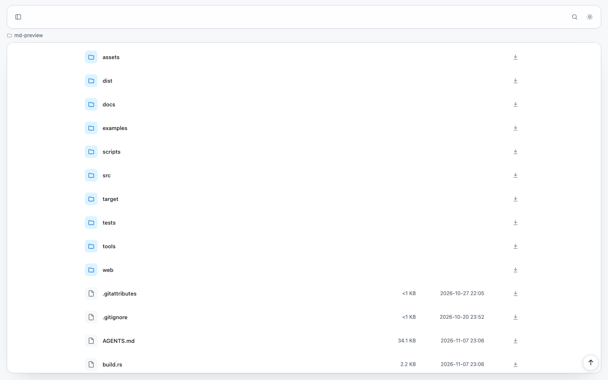

- 点击目录名进入子目录，点击文件名打开预览或源码页；
- 文件行右侧的下载图标直接下载原始文件；
- 文件夹行右侧的下载图标会把整个文件夹打包成 zip（见第 12 节）；
- 顶部面包屑显示当前路径；页脚右下角有“回到顶部”。

旧式 `index.html` 不会被自动当作目录首页，目录始终列出内容。

## 3. Markdown 预览

`.md` / `.markdown` 文件会渲染为文档：标题、段落、列表、引用、表格、代码块、
删除线、自动链接、图片都支持；相对链接与图片会被改写成站点根相对地址。


- 宽屏右侧是常驻目录（TOC），点击标题跳转；1100–1279px 收成细轨，悬停显示单条
  标题；窄屏回到正文顶部内联目录；
- 顶栏中间显示文件名；主岛顶部左侧是操作，右侧是类型、大小、编码、行数与更新时间；
- 代码块右上角有“复制”按钮，语言名显示在左上角；
- 图片可点击放大；链接悬停显示下划线。

## 4. 文件内查找与复制

文档页和源码页的主岛功能区都有“搜索”和“复制”。

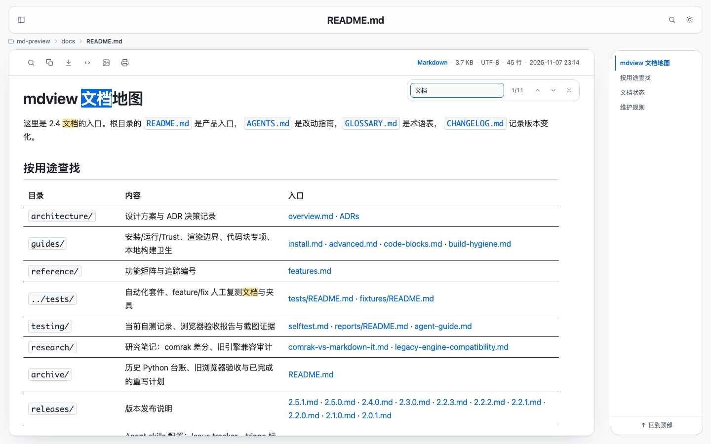

- 点“搜索”后在内容区右上浮出查找框；
- 输入文字即时匹配，显示 `当前/总数`；
- `Enter` 下一个，`Shift+Enter` 上一个，也可点上下箭头；`Esc` 关闭并清除高亮；
- 点“复制”会复制**原始全文**（Markdown 复制 Markdown 源码，不是渲染后的 HTML），
  成功后按钮变绿并显示“已复制”。

复制失败时按钮会短暂显示“复制失败”；如果浏览器没有剪贴板权限，请允许站点访问
剪贴板或改用 `?download=1` 下载原文件。

## 5. 源码页

非 Markdown 文本（`.txt`、`.rs`、`.py`、`.json`、`.log` 等）和 `?raw=1` 会打开
源码页：顶栏文件名，主岛顶部显示类型、大小、编码、行数与更新时间，正文带行号。

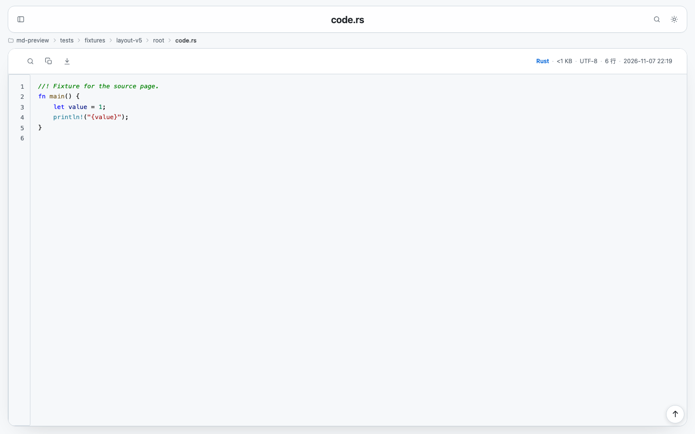

- 左侧行号可点击，地址变为 `#L<n>`，便于分享具体行；
- 编辑器风格的代码背景和行号栏会铺满主岛高度；长文件由主岛整体滚动；
- 主岛功能区提供搜索、复制、下载文件；Markdown 源码页额外有“预览”；
- 超过 256 KB 且超过 500 行的文件按 500 行分块，滚动时只高亮附近可见块；
- 单块超过 256K 字符的代码交给后台 Worker 高亮，3 秒超时后回落纯文本，
  页面不会因超大压缩文件卡住。

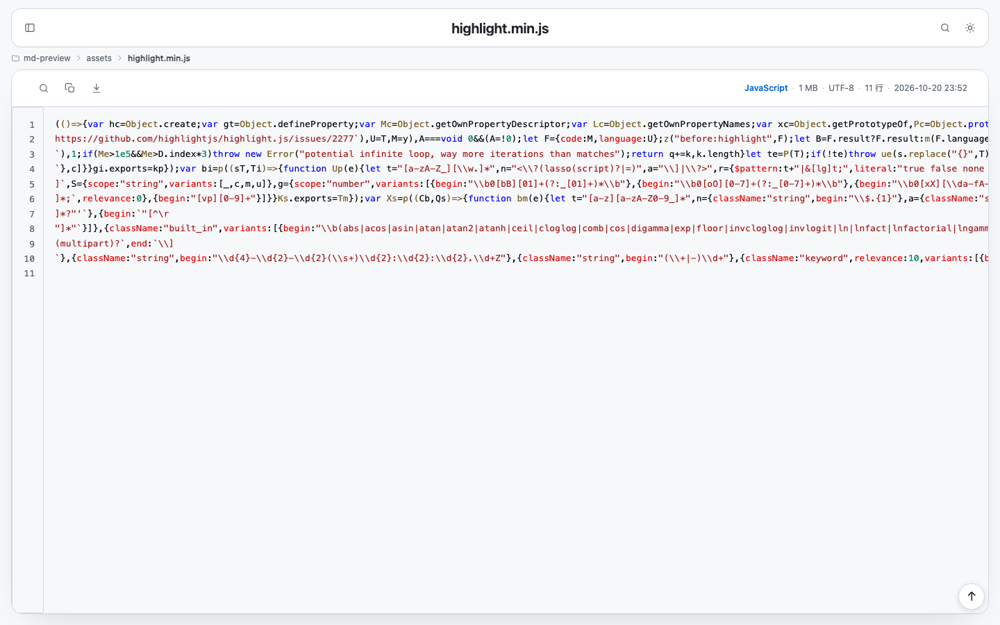

## 6. 全局搜索

点顶栏右侧搜索图标或按 `/` 打开搜索框，回车进入搜索页；也可以直接访问
`/search?__mdview=search&q=关键词`。

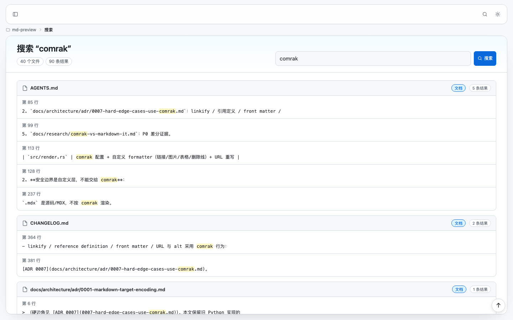

- 文件名搜索覆盖所有文件；
- 正文搜索覆盖 Markdown 与文本文件，按检测编码解码后匹配，不区分大小写；
- 结果按文件分组；点结果整行跳到对应文件或 Markdown 渲染行；
- 结果很多时底部出现“继续搜索”，分批追加而不是一次扫完整个根目录；
- 无 JS 时“继续搜索”会链接到下一批结果。

搜索会跳过隐藏目录、`node_modules` 等目录和超过 `--max-preview` 的文件。

## 7. 全站导航

点顶栏最左侧按钮打开导航浮层（窄屏是抽屉 + 遮罩）。

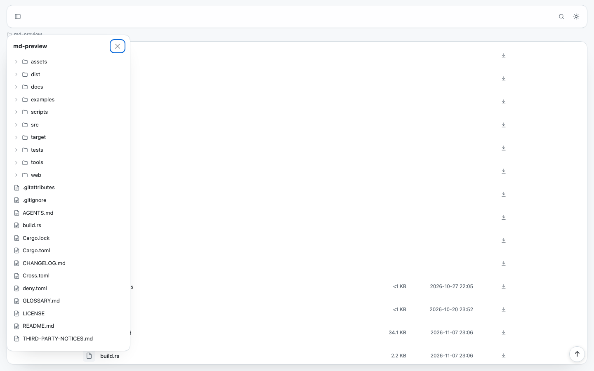

- 目录行只展开/收起，文件行才导航；
- 初始加载根目录与三层目录，展开更深目录时按需加载；
- 当前文件会自动展开并高亮；展开状态会记在 localStorage；
- 点击遮罩、`Esc` 或再次点按钮关闭。

## 8. 主题

顶栏右侧太阳/月亮按钮循环切换“跟随系统 → 浅色 → 深色”，选择会保存在
localStorage。按钮旁会短暂提示当前状态。

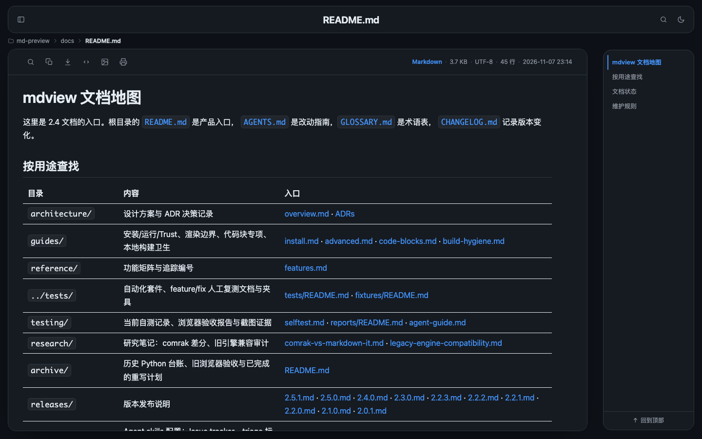

浅色与深色都使用 VS Code 风格的高亮主题（Light+ / Dark+），代码注释、关键字、
字符串、类型等颜色可读性一致。

## 9. 导出图片 / PDF

Markdown 文档页的“更多”操作里有“导出图片”和“导出 PDF”。

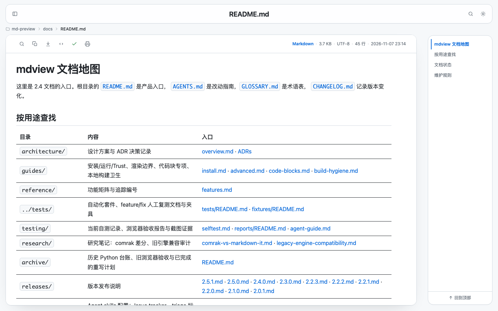

- 导出图片生成白底长图 PNG，固定浅色，自动降级；完成后按钮短暂变成绿色对勾；
- 导出 PDF 调起浏览器打印，自动隐藏顶栏、导航、目录与操作按钮并分页；
- 无 JS 时这两个按钮会隐藏。

## 10. HTML 文件

可信根下的 `.html` 会直接以原文打开：脚本、localStorage、同源 fetch、下载和普通
链接都可用，不套 mdview 外壳。


未信任根下的 HTML 会 302 到独立的 HTML 第二 origin（默认主端口 +1，`--html-port`
可覆盖），以只读静态镜像运行，避免未信任页面接触站点数据：

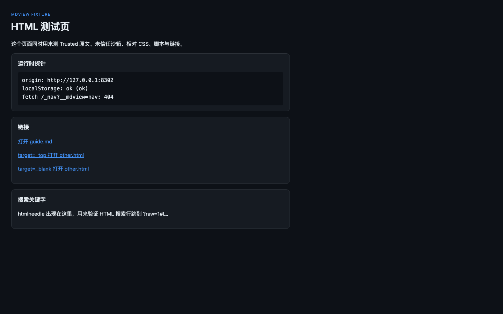

`?raw=1` 始终打开主 origin 的源码页；源码页“预览”会指向对应的原文地址。
`--safe` 下只提供源码，不启动第二 origin。

## 11. Trust 拦截面

未信任目录里的 Markdown 第一次打开会出现确认页。确认令牌 60 秒内有效、绑定路径、
只能使用一次；`?raw=1` 与 `?download=1` 不经过这个确认页。

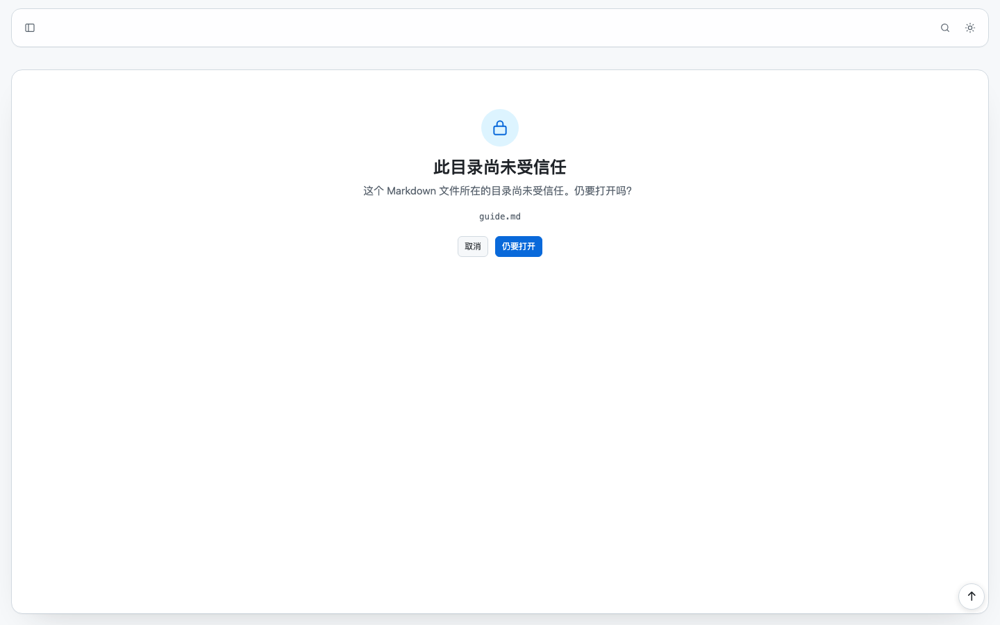

在 TTY 里启动时会询问是否信任当前根，并保存到用户配置目录的 `trust.toml`；
非交互环境默认不信任。也可以用 `--trust` / `--untrusted` 临时覆盖。

## 12. 压缩包与文件夹下载

压缩包以虚拟目录浏览，支持 ZIP（含 `.jar`/`.epub`/`.cbz` 等容器）、tar 家族与
`.7z`。

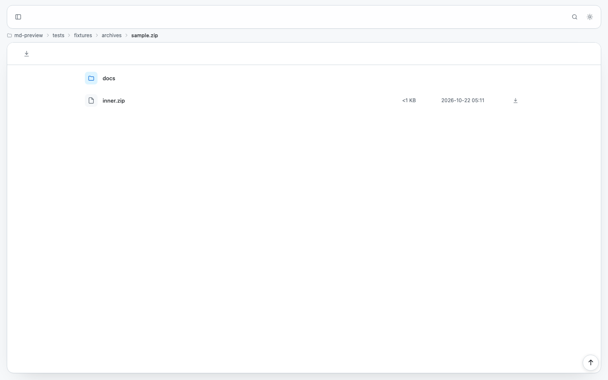

- 点压缩包进入包根，面包屑显示包名；主岛功能区有“下载压缩包”；
- 包内 Markdown、文本、HTML 源码、图片与下载复用普通文件管线；
- 嵌套压缩包按普通文件下载，不递归解压；
- 包内条目仍受 `--max-preview` 与 Trust 约束。

可信根下，目录页文件夹行的下载图标会把整个文件夹打包为 zip：

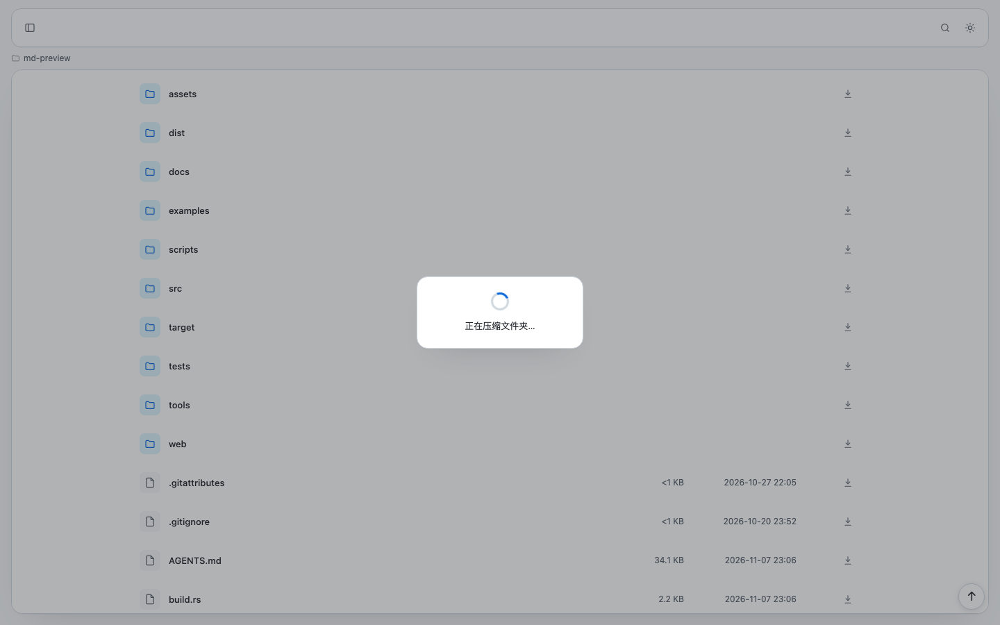

压缩期间显示全屏遮罩；zip 在系统临时目录生成，下载结束或中断后删除；只有可信根
且非 `--safe` 时提供该入口。

## 13. 文件编码

文本与 Markdown 会先检测 BOM、UTF-8、UTF-16 与常见 legacy 编码（GBK、Shift_JIS
等），页面显示检测结果；下载与 raw 保留原始字节。

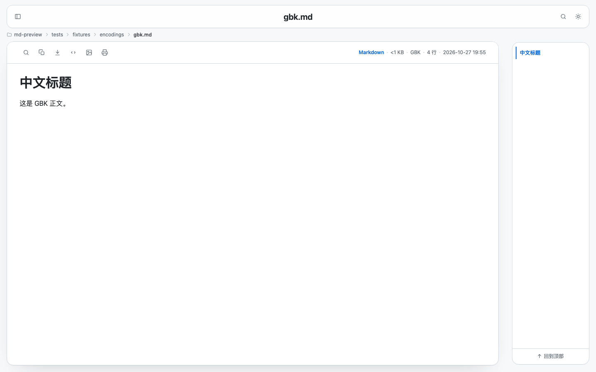

检测是启发式的：短小 legacy 文件可能被误判，无 BOM 的中文 UTF-16 可能识别失败；
UTF-32 按二进制下载。需要原始字节时用“下载”。

## 14. 图片、PDF 与其他文件

图片与 PDF 按 MIME 内联；SVG 直开带 `sandbox` CSP，脚本不执行。其他二进制文件
直接下载。


## 15. 错误页

不存在的路径会返回 404 页面；错误页使用统一的中文文案和“返回首页”入口。

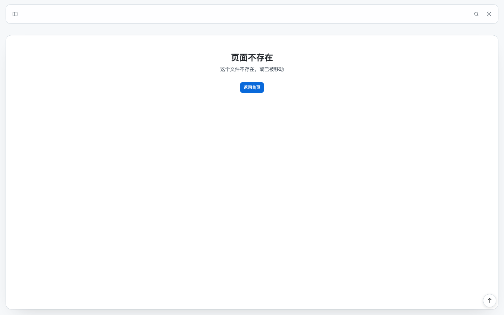

## 16. 无 JS 与快捷键

- 禁用 JavaScript 时：正文、源码全文、搜索页与目录仍可阅读；导航、主题切换、
  代码工具条、图片放大、TOC 岛等增强功能隐藏；
- `/` 打开搜索框，`Enter` 提交，`Esc` 关闭；
- 目录页、文档页、源码页右下角有“回到顶部”。

## 17. 已知限制

- 标题不生成 `id`，任务列表按字面量显示；
- 裸 URL 后的全角句末标点与 U+3000 空格会结束链接，但 URL 路径里的汉字保留；
- front matter 被消费；`.tar.zst`、RAR 与单文件压缩流按普通文件下载；
- 大文件（超过 `--max-preview`）默认改为下载。

更完整的边界与决策见 [`../reference/features.md`](../reference/features.md) 与
[`../architecture/adr/`](../architecture/adr/)。
