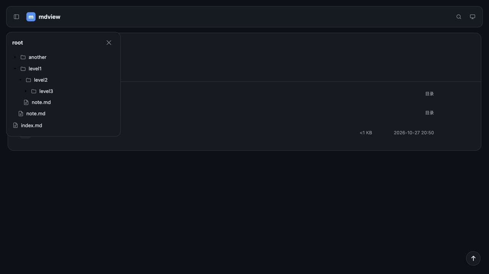
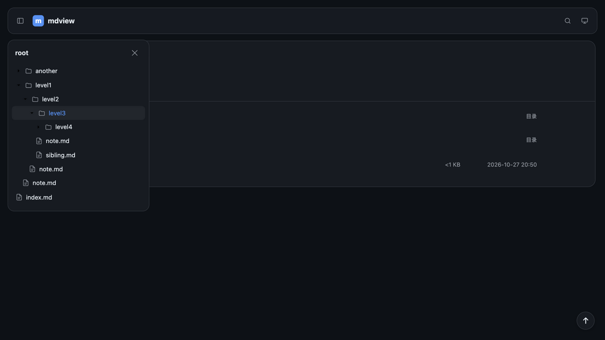
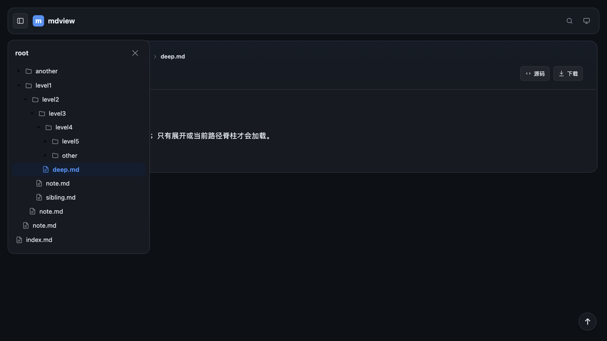

# 浏览器验收：全站导航分层预载（2026-10-26）

**被测版本**：mdview 2.1.0 工作树 + `feat/nav-layered-preload`
**验收方式**：release 二进制 + headless Chrome 自动探针 + 真实浏览器截图
**结论**：三层预载、第三层按需展开、深页当前路径脊柱定位均通过；未发现阻断问题。

## 环境

| 项 | 值 |
|---|---|
| 平台 | macOS 27.0.0 arm64 |
| 服务 | `target/release/mdview --root tests/fixtures/nav-lazy/root --trust` |
| 入口 | `/` 与 `/level1/level2/level3/level4/deep.md` |
| 用法 | 桌面浮岛，深色主题，默认收起后打开 |

## 自动套件

| 套件 | 结果 |
|---|---|
| `cargo test --lib` | **87 passed** |
| `cargo test --test render_compat` | **134 passed** |
| `cargo test --test golden` | **27 cases passed** |
| `bash tests/selftest-rust.sh` | **PASS=257 FAIL=0** |
| `node tests/browser-probe.mjs` | **PASS=224 FAIL=0** |

浏览器探针新增/更新覆盖：初始树不含第四层文件、展开一级/二级直接命中预载数据、
展开第三层发出一次 `dir=level1%2Flevel2%2Flevel3`、懒加载只返回一层、悬停预热
第四层、悬停与点击合并为一次请求、深页 `active` 脊柱自动展开并高亮当前文件、
脊柱不触发逐级请求。

## 视觉验收

### F-91 / F-46 三层预载边界

操作：打开导航 → 展开 `level1` → 展开 `level2`。

预期：`level1`、`level2`、`level3` 目录节点可见；`level3` 是占位，`sibling.md` 与
`level4/` 不出现。实际与预期一致。

### F-47 按需展开第三层

操作：点击 `level3`。

预期：只发一次 `/_nav?__mdview=nav&dir=level1/level2/level3`；出现同级
`sibling.md` 与 `level4/` 占位，但 `deep.md` 仍不出现。实际与预期一致。

### F-49 / F-46 深页当前路径脊柱

操作：直接打开 `/level1/level2/level3/level4/deep.md`，页面空闲预取完成后打开导航。

预期：`level1`–`level4` 自动展开，`deep.md` 高亮；同级 `level5/`、`other/` 仍是
占位；不需要逐级点击。实际与预期一致，且未产生 `dir=` 逐级请求。

## 观察与限制

- 导航浮岛打开后覆盖画布，正文宽度不变；三层边界与展开后的缩进、箭头方向正常。
- 第 3 层目录在展开前不知道是否为空，统一显示展开箭头；展开空目录会显示“空目录”。
- 单个超大目录仍会一次列出全部条目，未做分页/虚拟滚动；本轮不覆盖该场景。
- 本轮视觉验收聚焦桌面浮岛；≤900px 抽屉、遮罩与滚动由 `browser-probe.mjs` 覆盖。

## 结论

F-91 通过，F-46/F-47/F-49 的相关验收口径已同步；可以进入 PR 与全量验收。
