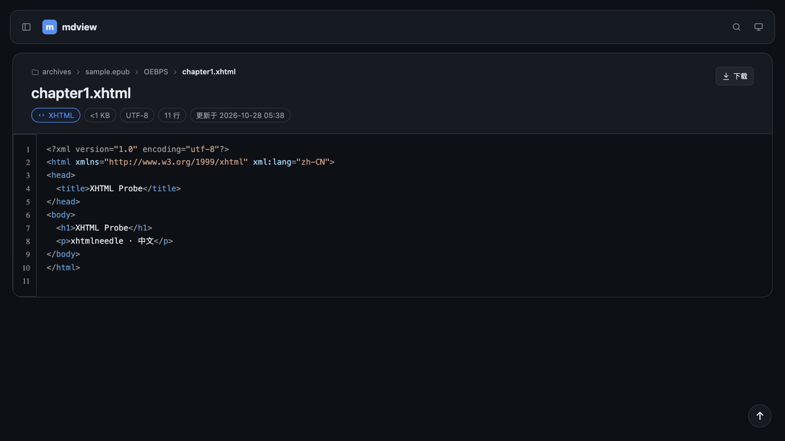
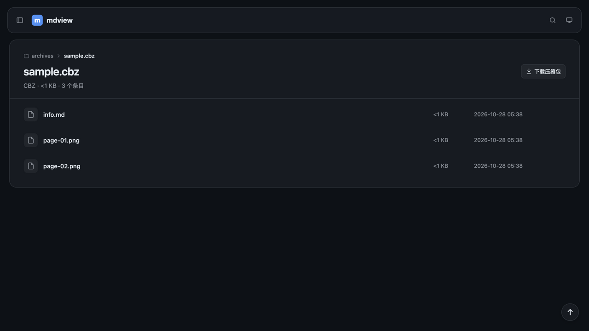
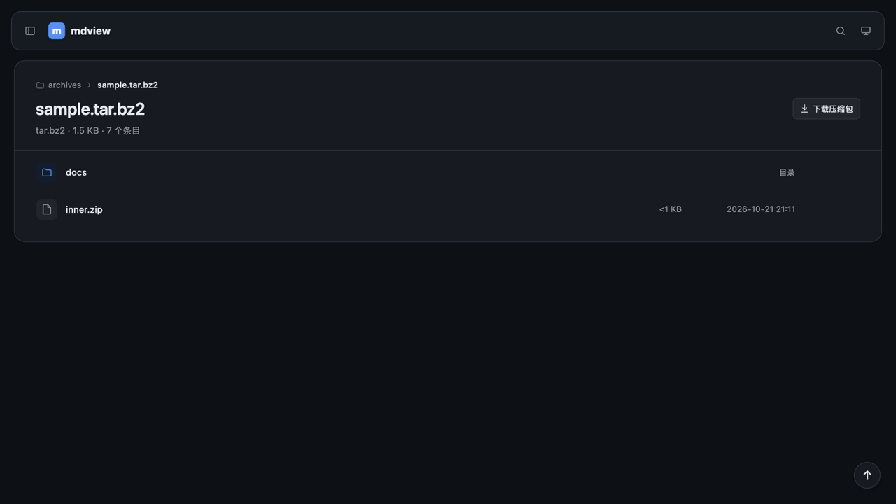

# 浏览器验收：压缩包格式扩展（2026-10-26）

**被测版本**：mdview 2.1.0 工作树 + `feat/archive-formats`
**验收方式**：release 二进制 + headless Chrome 自动探针 + 真实浏览器截图
**结论**：tar.bz2/tar.xz、JAR/EPUB/CBZ 容器与 `.xhtml` 源码页均通过；未发现阻断问题。

## 环境

| 项 | 值 |
|---|---|
| 平台 | macOS 27.0.0 arm64 |
| 服务 | `target/release/mdview --root tests/fixtures/archives --trust` |
| 入口 | `/sample.epub/`、`/sample.epub/OEBPS/chapter1.xhtml`、`/sample.cbz/`、`/sample.tar.bz2/` |
| 用法 | 桌面、深色主题 |

## 自动套件

| 套件 | 结果 |
|---|---|
| `cargo test --lib` | **88 passed** |
| `cargo test --test render_compat` | **134 passed** |
| `cargo test --test golden` | **27 cases passed** |
| `bash tests/selftest-rust.sh` | **PASS=274 FAIL=0** |
| `node tests/browser-probe.mjs` | **PASS=238 FAIL=0** |

覆盖点：扩展名/别名检测、xz 大字典拒绝、tar.bz2/tar.xz 条目渲染、JAR 清单
源码页、EPUB 章节源码页与行锚点、CBZ 图片内联、`.xhtml` 真实文件源码页、
嵌套包不递归、`--safe` 隐藏。

## 视觉验收

### F-92 EPUB 包根

操作：打开 `/sample.epub/`。

预期：页面标签为 `EPUB`；根目录列出 `META-INF/`、`OEBPS/`、`mimetype`；有
“下载压缩包”。实际与预期一致。

### F-92 EPUB 章节源码页

操作：打开 `/sample.epub/OEBPS/chapter1.xhtml`。

预期：进入文本源码页，标签为 `XHTML`，有行号、编码与行数；不渲染成电子书页面，
也不套 HTML 预览/沙箱。实际与预期一致。

### F-92 CBZ 包根

操作：打开 `/sample.cbz/`。

预期：页面标签为 `CBZ`；列出 `info.md`、`page-01.png`、`page-02.png`；图片走普通
图片预览。实际与预期一致。

### F-92 tar.bz2 包根

操作：打开 `/sample.tar.bz2/`。

预期：页面标签为 `tar.bz2`；列出 `docs/` 与嵌套 `inner.zip`；嵌套包不展开。实际与
预期一致。

## 观察与限制

- ZIP 容器只做归档浏览：`.epub` 不是阅读器，`.jar`/`.apk` 中的代码不会执行；
  `.xhtml` 只按源码页显示。
- `.tar.zst`、RAR/RAR5、单文件压缩流与 Office/ODF 容器仍按普通文件下载。
- xz 解码器内存上限 128 MiB；异常大字典的包会整包拒绝。
- 本轮视觉验收聚焦桌面包根与源码页；窄屏与既有目录布局由浏览器探针覆盖。

## 结论

F-92 通过，F-81 的压缩包虚拟路径口径已更新；可以进入 PR 与全量验收。
